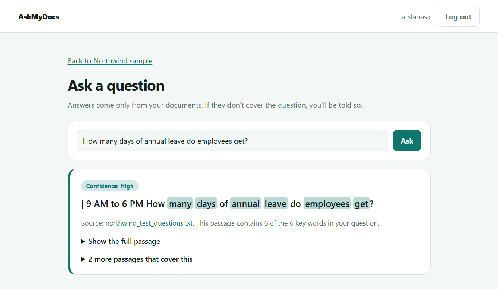
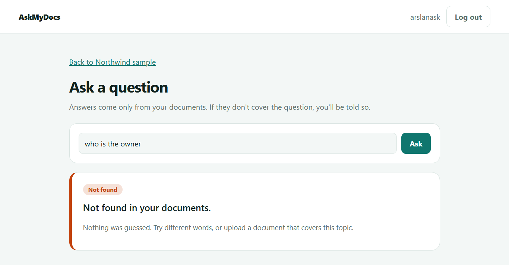
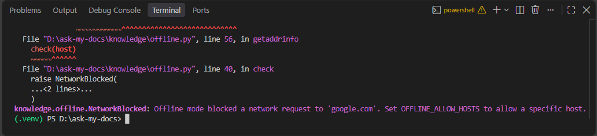

# AskMyDocs


Ask questions about your own PDF and text documents. It runs **entirely on your own server, with no AI service and no outside connections**, and it says "Not found in your documents" instead of guessing.

**Demo video:** https://youtu.be/Tspg8KWvDOs
**Try it with:** [sample document](sample_data/northwind_handbook.pdf) and [test questions](sample_data/northwind_test_questions.txt)

| Answer with source | Not found |
|---|---|
|  |  |

## Why this exists
Many companies cannot send their documents to an external AI service. AskMyDocs keeps the text on your own server and answers with the exact passage from your documents, so nothing can be invented.

## Features
- Upload PDF, TXT and Markdown files. Only the extracted text is stored, never the original file.
- Private workspaces per user, with delete for documents and whole workspaces
- BM25 keyword search with highlighted matches, file name and page number
- Cited answers: the best sentence plus its full passage, with a confidence label
- A "not found" threshold, so weak matches are refused instead of guessed
- **Accuracy test page:** write sample questions with the phrase the right answer should contain, and see how often the app gets them right, including questions it should refuse
- **Offline mode** (on by default): any outgoing network connection or public DNS lookup fails, and tests prove it
- Docker setup and automated tests with CI

## How it works
1. **Extract.** `pypdf` reads PDFs, and text files are decoded locally.
2. **Chunk.** Text is split into passages of about 900 characters with a small overlap.
3. **Rank.** BM25 scores passages for the question, with light word-form matching ("refunds" finds "refund").
4. **Decide.** The app answers only if one passage contains at least half of the question's key words. Otherwise it says not found.
5. **Show the source.** Every answer shows the file and page it came from.

## Measured results on the sample
Run on the fictional Northwind handbook (4 pages), with the test files in `sample_data/`:

| Question set | Result |
|---|---|
| 16 straightforward questions (13 answerable, 3 that should be refused) | 16 of 16 |
| 4 questions worded differently from the document | 1 of 4 |

The second row is the honest limit: keyword search matches words, not meaning, so "Can I get my money back?" misses a document that says "refund". A synonym list or a local embedding model would improve this. The sample is tiny, so treat the first row as a working check, not a benchmark. Write your own questions on the Accuracy test page for your own documents.

## Privacy
See [PRIVACY.md](PRIVACY.md). In short: no AI model, no telemetry, no third-party API, and offline mode blocks outgoing connections. This is not a compliance certificate, and you still need your own security review.



## Run locally
```bash
git clone https://github.com/Arslan3x5/ask-my-docs.git
cd ask-my-docs
python -m venv .venv
source .venv/bin/activate        # Windows: .venv\Scripts\activate
pip install -r requirements.txt
python manage.py migrate
python manage.py runserver
```
Open http://127.0.0.1:8000, create an account, make a workspace and upload `sample_data/northwind_handbook.pdf`.

Run the tests with `python manage.py test`.

## Run with Docker
```bash
echo "SECRET_KEY=$(python -c 'import secrets; print(secrets.token_urlsafe(50))')" > .env
docker compose up --build
```
Open http://localhost:8000. Data is kept in a Docker volume. For real use, put the app behind HTTPS and set `USE_HTTPS=1`, and consider running the container on a network with no internet access.

## Configuration
| Variable | Purpose |
|---|---|
| `SECRET_KEY` | Django secret key (required when `DEBUG=0`) |
| `DEBUG` | `1` for development, `0` for production |
| `ALLOWED_HOSTS` | Comma-separated hostnames |
| `CSRF_TRUSTED_ORIGINS` | Comma-separated origins, e.g. `https://docs.example.com` |
| `OFFLINE_MODE` | `1` (default) blocks outgoing connections |
| `OFFLINE_ALLOW_HOSTS` | Hosts allowed in offline mode, e.g. an internal database |
| `ANSWER_MIN_COVERAGE` | Share of question words a passage must contain to answer (default 0.5) |
| `UPLOAD_MAX_MB` | Maximum upload size (default 10) |
| `USE_HTTPS` | `1` enables secure cookies (default 1; set 0 for plain HTTP) |
| `DB_PATH` | Location of the SQLite database file |

## Limitations
- Keyword search, not meaning: reworded questions can be missed.
- Scanned PDFs need OCR, which is not included.
- One answer passage at a time. There is no summarising or rewriting.
- SQLite by default, so it suits small teams and demos.

## Roadmap
- [ ] Synonym list per workspace
- [ ] Optional local embeddings for meaning-based search
- [ ] OCR for scanned PDFs
- [ ] Embeddable search box and API key access

## License
MIT